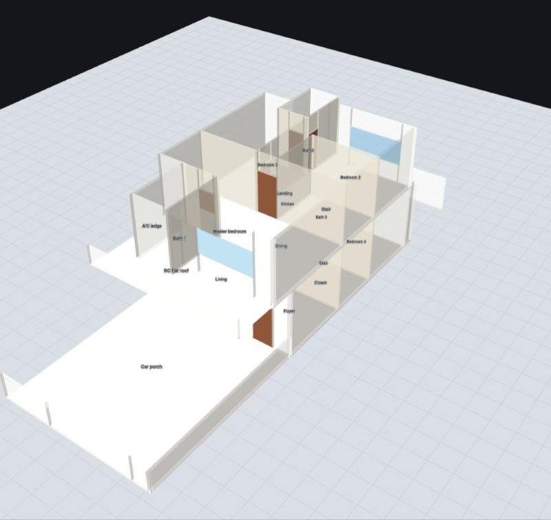
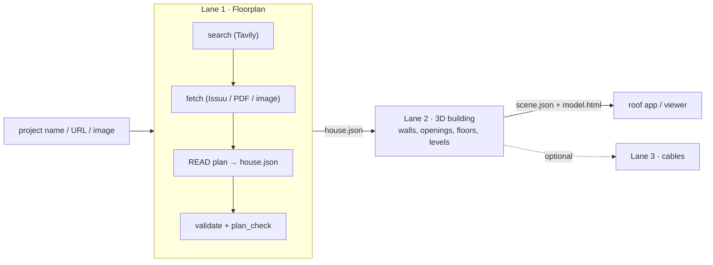
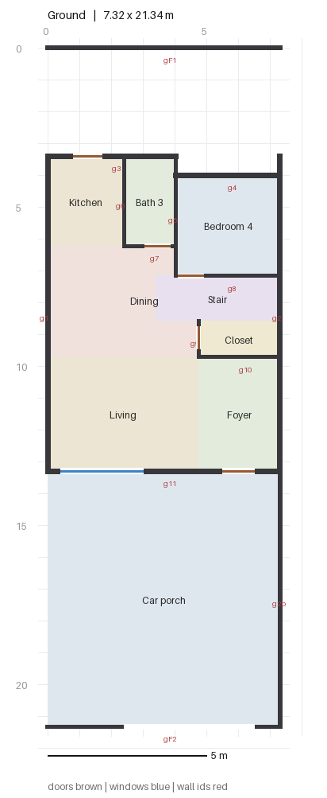
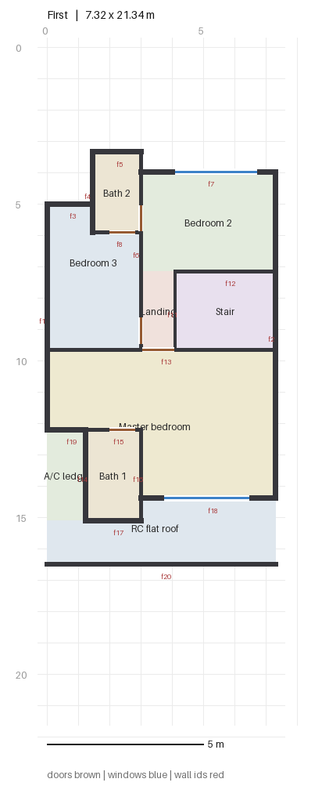

# floorplan-to-3d

**Give it a housing project name. Get back the floorplan, and a measured 3D model of the building.**

An AI-operated pipeline that finds a residential floorplan (brochure, Issuu leaflet, developer page), reads it into
clean geometry, checks that geometry against the dimensions printed on the plan, and builds an interactive 3D building you
can open in any browser. It was built for **home solar PV cable planning**, where what matters is a trustworthy layout,
wall positions and storey heights, and not a pretty render.

<p align="center">
  
  <br><em>Precinct Lumina Type A (24' x 70' double-storey terrace), generated from the developer's brochure.</em>
</p>

## Why this exists

Solar installers need cable lengths and routes *before* they visit. The only drawings most homeowners have are marketing
floorplans: flat images with printed dimensions. Turning those into something measurable is slow, error-prone work.
This repo makes it a repeatable, checkable pipeline that an AI agent (Claude Code) can run end to end.

## How it works: three lanes that only talk through files



| Lane | Does | Writes |
|---|---|---|
| **1 Floorplan** | Finds the plan with Tavily search, downloads it, **reads it with vision** into `house.json`, then proves the reading is right | `1_floorplan/house.json`, `source.json`, `plan_check_*.png` |
| **2 Model** | Turns `house.json` into a 3D building. **Refuses to build if the contract check fails** | `2_model/scene.json`, `model.html` |
| **3 Cables** *(optional)* | Cable routes, lengths, voltage drop from array positions supplied by another app | `3_pv/pv.json`, `cable_schedule.csv` |

**The roof is deliberately not modelled.** Roof profile and panel placement come from a separate app (Google Open Buildings +
Solar API); `scene.json` carries a `building` block (footprint, top height, north angle) so the two can be combined later.

### What makes the reading trustworthy
- **Measured, not eyeballed.** Plans are enlarged with a pixel ruler, and the scale is calibrated from two printed dimensions.
- **Reconciled to the plan.** The walls' footprint must match the size printed on the drawing (within 3 %) or the gate fails.
- **Visually cross-checked.** `plan_check` redraws `house.json` as a 2D plan to compare against the source drawing:

<p align="center">
  
  &nbsp;
  
</p>

- **Every guess is written down** in `_assumptions` (north direction, storey heights, wall thickness, which unit of a mirrored pair).

## Quick start

Requirements: Python 3.8+ and Pillow. PyMuPDF only if a source is a PDF. The viewer works offline.

```bash
pip install --user pillow pymupdf          # pymupdf is optional (PDF brochures)
python3 pipeline/run.py doctor             # environment check -> READY
python3 pipeline/run.py run lumina-type-a  # rebuild the bundled example (gate + 3D)
open projects/lumina-type-a/2_model/model.html
```

Other commands: `run.py new "<name>"`, `run.py list`, `run.py status <slug>`, and the tests:
`python3 pipeline/tests/run_tests.py` (28 offline tests, under a second).

**Web search (optional):** copy `.env.example` to `.env` and add a [Tavily](https://tavily.com) key. Without it, give the pipeline
a URL or file instead.

### Use it with an AI agent
Open the repo in Claude Code and run `/floorplan-to-3d <project name>`. The agent manual is
[`AGENTS.md`](AGENTS.md) (commands, how to read and measure a plan, the gate, troubleshooting); file formats are in
[`CONTRACTS.md`](CONTRACTS.md). Per-lane skills: `/lane1-floorplan`, `/lane2-model`, `/lane3-pv`.

## Worked example: Precinct Lumina Type A

| | |
|---|---|
| Project | Precinct Lumina, Taman Daiman Jaya, Kota Tinggi, Johor (Daiman Development) |
| Unit | Type A, 24' x 70' double-storey terrace, intermediate unit (left of a mirrored pair) |
| Source | Developer's e-brochure PDF (URL recorded in `projects/lumina-type-a/1_floorplan/source.json`) |
| Printed size | 7,315 mm wide on a 21,336 mm plot. Reproduced by the model |
| Scale | ~21 px/m (about 5 cm per pixel) → expect ±10 cm |
| Output | 2 levels, 32 walls, 14 openings, 18 rooms |

Also in `projects/`: `nada3a` (leaflet with a section, includes a legacy roof + PV/cable demo), `demo` (synthetic),
`nilam3-type-b` (sources recorded, not yet read).

## Repository layout

```
AGENTS.md  CONTRACTS.md  CLAUDE.md        agent manual · file formats · Claude Code entry point
pipeline/run.py                            orchestrator + doctor
pipeline/common/                           shared contract check, project paths, viewer (three.js r147, checksummed)
pipeline/lane1_floorplan/                  search · fetch · validate · plan_check
pipeline/lane2_model/                      build_model
pipeline/lane3_pv/                         optional cable planning
pipeline/tests/                            offline regression suite + fixtures
projects/<slug>/                           1_floorplan · 2_model · 3_pv per house
.claude/skills/                            floorplan-to-3d, lane1-floorplan, lane2-model, lane3-pv
```

## Limits (read before relying on it)
- Accuracy is that of the source image, typically ±10-15 cm. Good for cable lengths, not for construction.
- Storey heights are assumptions unless a section drawing gives them. North is assumed when the plan has no arrow.
- Walls are boxes along centre lines. Stairs, furniture and curved walls are not modelled.
- Cable results are indicative: ampacity, derating, protection, fire setbacks, shading and local code are **not** checked.
  A licensed installer must verify on site.

## Third-party material
Developer brochures and plans are downloaded only to read them and are **not** included in this repo (`projects/*/1_floorplan/source/`
is git-ignored; `source.json` keeps the URLs). The 3D examples are our own measured reconstructions. The viewer bundles
[three.js](https://threejs.org) r147 (MIT).

## Status
Working prototype. Lanes 1-2 are the supported path and are covered by tests; lane 3 is optional and legacy-roof-aware.
Next: combine with the Open Buildings / Solar roof app, using `scene.json`'s `building` block.
